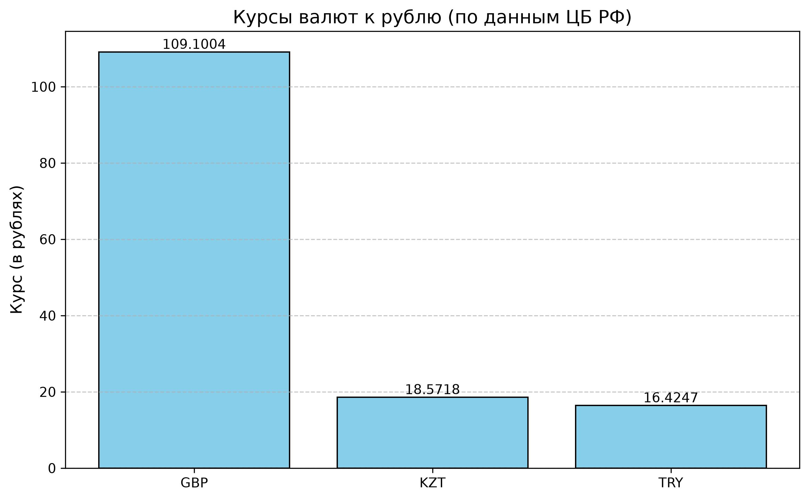

# Singleton Practice

## Визуализация курсов валют

Ниже представлен график курсов валют (на 11.11.26), полученный с неофициального JSON-зеркала ЦБ РФ:



---

## Инструкция по запуску

### 1. Установка зависимостей
Перед первым запуском проекта необходимо установить сторонние библиотеки.
Откройте терминал в папке с проектом и выполните команду:

```bash
pip install -r requirements.txt
```
### 2. Запуск программы
После успешной установки зависимостей запустите главный файл программы:

```bash
python provider.py
```

После запуска в папке с проектом появится файл currencies.jpg с актуальным графиком курсов валют.

---
## Выполнила: Жукова София Романовна 2обПОО


